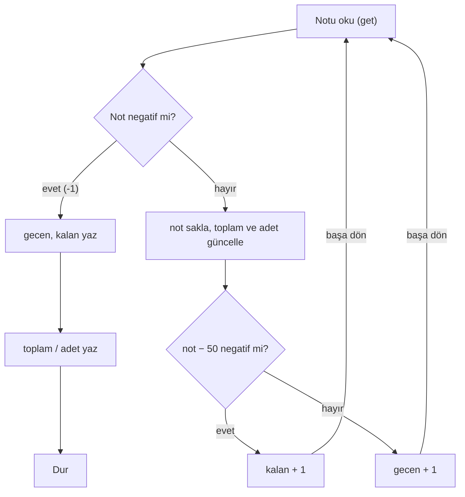

# Hafta 2, A Grubu: Sınıf Notları (Hoca Notu)

Bu dosya yalnızca hocalar içindir. Soru metni `Hafta-2-A.md` dosyasındadır. B grubunun sorusu (Market kasası) bu soruyla aynı becerileri ölçer, ama A grubunun çözümü B grubuna uymaz. Karşılaştırma için en alttaki tabloya bakınız.

## Neyi ölçüyoruz

- **Bitiş işaretine kadar okuma.** 0 geçerli bir not olduğu için bitiş işareti `-1`'dir ve `ifneg` ile yakalanır.
- **Karşılaştırmayı çıkarmayla kurmak.** Makinede "büyük mü" komutu yok. `not − 50` farkının işaretine bakılır. 50 sınırda olduğu için `ifneg` (< 0) ile `ifpos` (>= 0) arasındaki farkı bilmek gerekir.
- **Akümülatör ile bellek farkı.** `sub 50` akümülatördeki notu bozar. Not önce `store not` ile saklanmalıdır.
- **Birden fazla sayaç.** Geçen, kalan, adet ve toplam ayrı hücrelerde tutulur ve her biri doğru dalda güncellenir.
- **Döngüden sonra hesap.** Ortalama `toplam / adet` olarak döngü bittikten sonra bir kez hesaplanır.

## Önce cümlelerle yazalım

Programı yazmadan önce ne yapacağımızı satır satır Türkçe cümlelerle yazıyoruz. Sonra her cümleyi bir ya da birkaç komuta çeviriyoruz.

**Hangi bilgileri hatırlamamız gerekiyor?**

- `not`: o an okunan not
- `toplam`: şimdiye kadar okunan notların toplamı
- `adet`: şimdiye kadar okunan not sayısı
- `gecen`: geçen öğrenci sayısı
- `kalan`: kalan öğrenci sayısı

Hepsi başta 0.

**Adımlar**

1. Bir not oku.
2. Not negatifse (yani `-1` ise) okuma bitti, 9. adıma git.
3. Notu `not` hücresine sakla.
4. Notu `toplam`a ekle.
5. `adet`i 1 artır.
6. Nottan 50 çıkar. Sonuç negatifse öğrenci kaldı, 8. adıma git.
7. Öğrenci geçti: `gecen`i 1 artır ve 1. adıma dön.
8. Öğrenci kaldı: `kalan`ı 1 artır ve 1. adıma dön.
9. `gecen`i yaz.
10. `kalan`ı yaz.
11. `toplam`ı `adet`e böl ve sonucu yaz.
12. Dur.

**Cümleden komuta**

| Adım | Cümle | Komutlar |
| --- | --- | --- |
| 1 | Bir not oku. | `get` |
| 2 | Negatifse bitir. | `ifneg bitir` |
| 3 | Notu sakla. | `store not` |
| 4 | Toplama ekle. | `add toplam`, `store toplam` |
| 5 | Adedi 1 artır. | `load adet`, `add 1`, `store adet` |
| 6 | Nottan 50 çıkar, negatifse kaldı. | `load not`, `sub 50`, `ifneg kaldi` |
| 7 | Geçeni 1 artır, başa dön. | `load gecen`, `add 1`, `store gecen`, `goto basla` |
| 8 | Kalanı 1 artır, başa dön. | `load kalan`, `add 1`, `store kalan`, `goto basla` |
| 9–10 | Geçeni ve kalanı yaz. | `load gecen`, `print`, `load kalan`, `print` |
| 11 | Ortalamayı yaz. | `load toplam`, `div adet`, `print` |
| 12 | Dur. | `stop` |

4. adımda akümülatörde zaten not olduğu için `load not` yazmaya gerek yok. 6. adımda ise akümülatörde toplam var, bu yüzden notu yeniden `load not` ile getiriyoruz. 3. adımda notu bu yüzden sakladık.

## Çözüm

```
basla   get
        ifneg bitir
        store not
        add toplam
        store toplam
        load adet
        add 1
        store adet
        load not
        sub 50
        ifneg kaldi
        load gecen
        add 1
        store gecen
        goto basla
kaldi   load kalan
        add 1
        store kalan
        goto basla
bitir   load gecen
        print
        load kalan
        print
        load toplam
        div adet
        print
        stop
not     0
toplam  0
adet    0
gecen   0
kalan   0
```

27 komut, 5 bellek hücresi.

### Kabul edilecek farklı çözümler

- `adet` hücresi yerine ortalama `toplam / (gecen + kalan)` ile hesaplanabilir.
- Karşılaştırma `sub 50` + `ifpos gecti` ile, dallar ters sırada da kurulabilir.
- Soruda en az bir not girileceği söylendiği için sıfıra bölme kontrolü (`load adet`, `ifzero son`) zorunlu değildir. Ekleyen öğrenciye artı puan verilebilir.

## Çözüm nasıl çalışır

1. `get` ile not okunur. Negatifse (`-1`) `bitir` etiketine atlanır.
2. Not `not` hücresine saklanır, `toplam`a eklenir ve `adet` 1 artırılır.
3. `sub 50` ile `not − 50` hesaplanır. Sonuç negatifse `kaldi` dalında `kalan` 1 artar. Değilse `gecen` 1 artar. İki dal da `goto basla` ile başa döner.
4. `-1` gelince `gecen`, `kalan` ve `toplam / adet` sırayla yazdırılır.

Örnek 1'de hücreler şöyle değişir:

| Girilen not | not − 50 | Dal | gecen | kalan | adet | toplam |
| --- | --- | --- | --- | --- | --- | --- |
| 85 | 35 | geçti | 1 | 0 | 1 | 85 |
| 40 | −10 | kaldı | 1 | 1 | 2 | 125 |
| 50 | 0 | geçti | 2 | 1 | 3 | 175 |
| 0 | −50 | kaldı | 2 | 2 | 4 | 175 |
| 75 | 25 | geçti | 3 | 2 | 5 | 250 |
| 50 | 0 | geçti | 4 | 2 | 6 | 300 |
| −1 | | bitiş | | | | |

Çıktı: `4`, `2`, `300 / 6 = 50`.

## Akış şeması



## Test girdileri

| Girdiler | Beklenen çıktı | Neyi yoklar |
| --- | --- | --- |
| `85, 40, 50, 0, 75, 50, -1` | `4`, `2`, `50` | Örnek 1, 50 ve 0 sınırları |
| `90, 30, -1` | `1`, `1`, `60` | Örnek 2 |
| `0, -1` | `0`, `1`, `0` | 0 notunun bitiş sanılmaması |
| `100, 100, 49, -1` | `2`, `1`, `83` | 49'un kalması |
| `50, -1` | `1`, `0`, `50` | Tek not, tam sınır |

## Sık yapılan hatalar

| Hata | Örnek 1'de çıkan sonuç |
| --- | --- |
| Bitiş için `ifzero` kullanmak (0'ı bitiş sanmak) | `2`, `1`, `58.33…` (0'dan sonraki notlar kaybolur) |
| `gecen` dalının sonunda `goto basla` unutmak | `4`, `6`, `50` (geçenler kalan olarak da sayılır) |
| Notu saklamadan `sub 50` sonrasını toplama eklemek | `4`, `2`, `0` |
| `sub 51` yazmak ya da dalları ters bağlamak | 50 alanlar kalmış sayılır: `2`, `4`, `50` |
| `toplam` yerine `adet`i bölmek, ya da bölmeyi döngü içinde yapmak | Ortalama yanlış ya da her turda yazdırılır |

Not: Simülatörde `div` ondalıklı böler. Ortalaması tam çıkmayan bir girdide `49.33…` gibi bir sonuç hata değildir.

## Puanlama (100 puan)

İki grupta da aynı ölçütler ve aynı puanlar kullanılır.

| Ölçüt | Puan |
| --- | --- |
| Döngü `-1` ile bitiyor, 0 geçerli not olarak sayılıyor | 20 |
| 50 sınırı doğru, 50 alan öğrenci geçiyor | 20 |
| Geçen ve kalan sayıları doğru | 20 |
| Toplam ve adet doğru tutuluyor | 15 |
| Ortalama döngüden sonra doğru hesaplanıyor | 20 |
| Çıktılar doğru sırada, program `stop` ile bitiyor | 5 |

## A ve B grubunun karşılaştırması

| Beceri | A: Sınıf notları | B: Market kasası |
| --- | --- | --- |
| Bitiş işareti | `-1`, `ifneg` ile | `0`, `ifzero` ile |
| Sabitle karşılaştırma | ≥ 50 (eşit dahil), tek `ifneg` | > 20 (eşit hariç), `ifneg` + `ifzero` |
| Sayaç | 2 sayaç + adet | 1 sayaç |
| Toplam | Notların toplamı | Fiyatların toplamı |
| Döngüden sonra hesap | Değişkene bölme (`div adet`) | Sabite bölme, tam kısım ve kalan (`mod 50`, `div 50`) |
| Çıktı | 3 değer | 3 değer |
| Çözüm uzunluğu | 27 komut, 5 hücre | 25 komut, 4 hücre |

A grubunda fazladan sayaç var. B grubunda ise bölmenin tam kısmını ve kalanını ayrı ayrı bulmak gerekiyor. İki soru bu yüzden yaklaşık aynı zorlukta.
