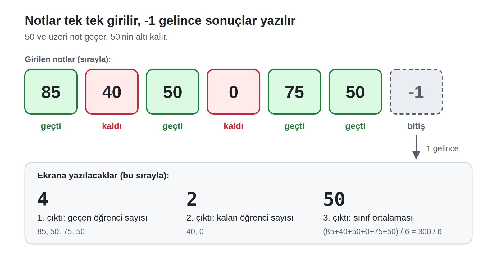

# Oyuncak Makine Uygulama Sınavı: A Grubu

**Süre:** 60 dakika · **Puan:** 100

Programınızı [Oyuncak Makine](https://toy.emrecan.dev/) simülatöründe yazınız ve çalıştırınız. Programınızı sadece verilen örneklerle değil, kendi seçtiğiniz girdilerle de deneyiniz.

**Hatırlatma**

- Komut satırları en az bir boşlukla başlar. Sadece etiketler (`basla`, `bitir` gibi) satırın en başından yazılır.
- Programınızı `stop` komutuyla bitirmeyi unutmayınız.
- Bellek hücrelerini programın sonunda tanımlayınız, örneğin `toplam  0`.

---

## Soru: Sınıf notları

**Durum:** Öğretmen sınavdan sonra öğrencilerin notlarını bilgisayara tek tek giriyor. Notlar 0 ile 100 arasında. Bütün notları girince `-1` giriyor. `-1` "notlar bitti" demek, bir not değil.

50 ve üzeri not alan öğrenci **geçer**, 50'nin altında not alan öğrenci **kalır**.

**Görev:** `-1` girilene kadar notları okuyunuz. Giriş bitince sırasıyla şunları ekrana yazınız:

1. Geçen öğrenci sayısı
2. Kalan öğrenci sayısı
3. Sınıf ortalaması (bütün notların aritmetik ortalaması)

**Örnek**

| Girdiler | Ekrana yazılanlar |
| --- | --- |
| `85, 40, 50, 0, 75, 50, -1` | `4`, `2`, `50` |
| `90, 30, -1` | `1`, `1`, `60` |

**Açıklamalar**

- 0 geçerli bir nottur.
- 50 alan öğrenci geçer.
- `-1` bir not değildir, hesaplamalara katılmaz.
- En az bir not girilecektir.
