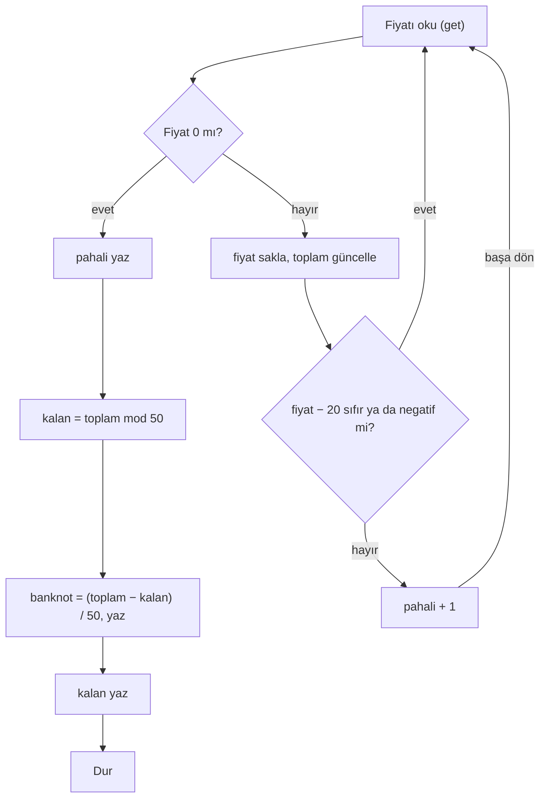

# Hafta 2, B Grubu: Market Kasası (Çözüm)

Soru metni `Hafta-2-B.md` dosyasındadır. A grubunun sorusu (Sınıf notları) bu soruyla aynı becerileri ölçer, ama B grubunun çözümü A grubuna uymaz. Karşılaştırma için en alttaki tabloya bakınız.

## Bu soru neyi ölçer

- **Bitiş işaretine kadar okuma.** Bu soruda fiyatlar en az 1 TL, bitiş işareti `0`'dır ve `ifzero` ile yakalanır. Dersteki `-1` kalıbını ezberden kullanmak burada hataya yol açar.
- **Karşılaştırmayı çıkarmayla kurmak.** "20'den fazla" kesin bir karşılaştırma. `fiyat − 20` sıfır ya da negatifse ürün pahalı değildir. Bu yüzden `ifneg` tek başına yetmez, `ifzero` da gerekir (ya da tam sayı olduğu için `sub 21` + `ifneg`).
- **Akümülatör ile bellek farkı.** `sub 20` akümülatördeki fiyatı bozar. Fiyat önce `store fiyat` ile saklanmalıdır.
- **Sayaç ve toplam.** Pahalı ürün sayısı ve toplam tutar ayrı hücrelerde tutulur.
- **Döngüden sonra hesap.** Banknot sayısı ve kalan, döngü bittikten sonra toplamdan hesaplanır. `div` ondalıklı böldüğü için tam kısım ayrıca bulunmalıdır.

## Önce cümlelerle yazalım

Programı yazmadan önce ne yapacağımızı satır satır Türkçe cümlelerle yazıyoruz. Sonra her cümleyi bir ya da birkaç komuta çeviriyoruz.

**Hangi bilgileri hatırlamamız gerekiyor?**

- `fiyat`: o an okunan fiyat
- `toplam`: şimdiye kadar okunan fiyatların toplamı
- `pahali`: pahalı ürün sayısı
- `kalan`: 50 TL'lik banknotlardan sonra kalan tutar

Hepsi başta 0.

**Adımlar**

1. Bir fiyat oku.
2. Fiyat 0 ise okuma bitti, 7. adıma git.
3. Fiyatı `fiyat` hücresine sakla.
4. Fiyatı `toplam`a ekle.
5. Fiyattan 20 çıkar. Sonuç negatif ya da 0 ise ürün pahalı değil, 1. adıma dön.
6. Ürün pahalı: `pahali`yı 1 artır ve 1. adıma dön.
7. `pahali`yı yaz.
8. `toplam`ın 50'ye bölümünden kalanı bul ve `kalan` hücresine sakla.
9. `toplam`dan `kalan`ı çıkar, sonucu 50'ye böl ve yaz. Bu, banknot sayısıdır.
10. `kalan`ı yaz.
11. Dur.

**Cümleden komuta**

| Adım | Cümle | Komutlar |
| --- | --- | --- |
| 1 | Bir fiyat oku. | `get` |
| 2 | 0 ise bitir. | `ifzero bitir` |
| 3 | Fiyatı sakla. | `store fiyat` |
| 4 | Toplama ekle. | `add toplam`, `store toplam` |
| 5 | Fiyattan 20 çıkar, negatif ya da 0 ise başa dön. | `load fiyat`, `sub 20`, `ifneg basla`, `ifzero basla` |
| 6 | Pahalıyı 1 artır, başa dön. | `load pahali`, `add 1`, `store pahali`, `goto basla` |
| 7 | Pahalıyı yaz. | `load pahali`, `print` |
| 8 | Kalanı bul, sakla. | `load toplam`, `mod 50`, `store kalan` |
| 9 | Banknot sayısını bul, yaz. | `load toplam`, `sub kalan`, `div 50`, `print` |
| 10 | Kalanı yaz. | `load kalan`, `print` |
| 11 | Dur. | `stop` |

9. adımda doğrudan `toplam`ı 50'ye bölseydik 113 için `2.26` çıkardı. Önce kalanı çıkarınca bölme tam sayı verir: (113 − 13) / 50 = 2.

## Çözüm

```
basla   get
        ifzero bitir
        store fiyat
        add toplam
        store toplam
        load fiyat
        sub 20
        ifneg basla
        ifzero basla
        load pahali
        add 1
        store pahali
        goto basla
bitir   load pahali
        print
        load toplam
        mod 50
        store kalan
        load toplam
        sub kalan
        div 50
        print
        load kalan
        print
        stop
fiyat   0
toplam  0
pahali  0
kalan   0
```

25 komut, 4 bellek hücresi.

### Doğru kabul edilen farklı çözümler

- Karşılaştırma `sub 21` + `ifneg basla` ile yapılabilir (fiyatlar tam sayı).
- Banknot sayısı `mod` ve `div` yerine bir döngüyle bulunabilir: toplamdan 50 çıkarılır, sonuç negatif olmadıkça banknot sayacı artırılır, kalan da en son geçerli değerdir. Bu çözüm daha uzundur, ama tam puan almalıdır.
- Kalan `mod 50` yerine `toplam − banknot × 50` olarak (`mul 50` ile) hesaplanabilir.

## Çözüm nasıl çalışır

1. `get` ile fiyat okunur. `0` ise `bitir` etiketine atlanır.
2. Fiyat `fiyat` hücresine saklanır ve `toplam`a eklenir.
3. `sub 20` ile `fiyat − 20` hesaplanır. Sonuç negatif ya da sıfırsa ürün pahalı değildir ve doğrudan başa dönülür. Pozitifse `pahali` 1 artar.
4. `0` gelince `pahali` yazdırılır.
5. `toplam mod 50` kalanı verir ve `kalan` hücresine yazılır. `(toplam − kalan) / 50` tam sayı çıkar, bu da banknot sayısıdır.
6. Banknot sayısı ve kalan sırayla yazdırılır.

Örnek 1'de hücreler şöyle değişir:

| Girilen fiyat | fiyat − 20 | Pahalı mı | pahali | toplam |
| --- | --- | --- | --- | --- |
| 20 | 0 | hayır | 0 | 20 |
| 35 | 15 | evet | 1 | 55 |
| 5 | −15 | hayır | 1 | 60 |
| 40 | 20 | evet | 2 | 100 |
| 13 | −7 | hayır | 2 | 113 |
| 0 | | bitiş | | |

Döngüden sonra: `113 mod 50 = 13`, `(113 − 13) / 50 = 2`. Çıktı: `2`, `2`, `13`.

## Akış şeması



## Test girdileri

| Girdiler | Beklenen çıktı | Neyi yoklar |
| --- | --- | --- |
| `20, 35, 5, 40, 13, 0` | `2`, `2`, `13` | Örnek 1, 20 sınırı |
| `8, 30, 0` | `1`, `0`, `38` | Örnek 2, toplam 50'den az |
| `50, 0` | `1`, `1`, `0` | Tam bölünme, kalan 0 |
| `21, 20, 19, 0` | `1`, `1`, `10` | 21 pahalı, 20 değil |
| `100, 100, 100, 0` | `3`, `6`, `0` | Büyük toplam |

## Sık yapılan hatalar

| Hata | Örnek 1'de çıkan sonuç |
| --- | --- |
| Bitiş için `ifneg` kullanmak (A grubu kalıbı) | 0 bitiş sayılmaz, program yeni girdi bekler, sonuç hiç yazılmaz |
| Yalnızca `ifneg` ile karşılaştırmak (20'yi pahalı saymak) | `3`, `2`, `13` |
| Doğrudan `toplam div 50` yazmak | `2`, `2.26`, `13` |
| Fiyatı saklamadan `sub 20` sonrasını toplama eklemek | Toplam her üründe 20 eksik çıkar: `2`, `0`, `13` |
| Pahalı dalının sonunda `goto basla` unutmak | Program `bitir` kısmına düşer, ilk pahalı üründen sonra durur |
| Banknot ve kalanı döngü içinde hesaplamak | Her turda çıktı yazılır |

## Puanlama (100 puan)

İki grupta da aynı ölçütler ve aynı puanlar kullanılır.

| Ölçüt | Puan |
| --- | --- |
| Döngü `0` ile bitiyor, `0` hesaplamalara katılmıyor | 20 |
| 20 sınırı doğru, 20 TL'lik ürün pahalı sayılmıyor | 20 |
| Pahalı ürün sayısı doğru | 20 |
| Toplam tutar doğru tutuluyor | 15 |
| Banknot sayısı (tam sayı) ve kalan döngüden sonra doğru hesaplanıyor | 20 |
| Çıktılar doğru sırada, program `stop` ile bitiyor | 5 |

Banknot sayısı `2.26` gibi ondalıklı yazılıp kalan doğru bulunursa bu ölçütten 10 puan alınır.

## A ve B grubunun karşılaştırması

| Beceri | A: Sınıf notları | B: Market kasası |
| --- | --- | --- |
| Bitiş işareti | `-1`, `ifneg` ile | `0`, `ifzero` ile |
| Sabitle karşılaştırma | ≥ 50 (eşit dahil), tek `ifneg` | > 20 (eşit hariç), `ifneg` + `ifzero` |
| Sayaç | 2 sayaç + adet | 1 sayaç |
| Toplam | Notların toplamı | Fiyatların toplamı |
| Döngüden sonra hesap | Değişkene bölme (`div adet`) | Sabite bölme, tam kısım ve kalan (`mod 50`, `div 50`) |
| Çıktı | 3 değer | 3 değer |
| Çözüm uzunluğu | 27 komut, 5 hücre | 25 komut, 4 hücre |

A grubunda fazladan sayaç var. B grubunda ise bölmenin tam kısmını ve kalanını ayrı ayrı bulmak gerekiyor. İki soru bu yüzden yaklaşık aynı zorlukta.
