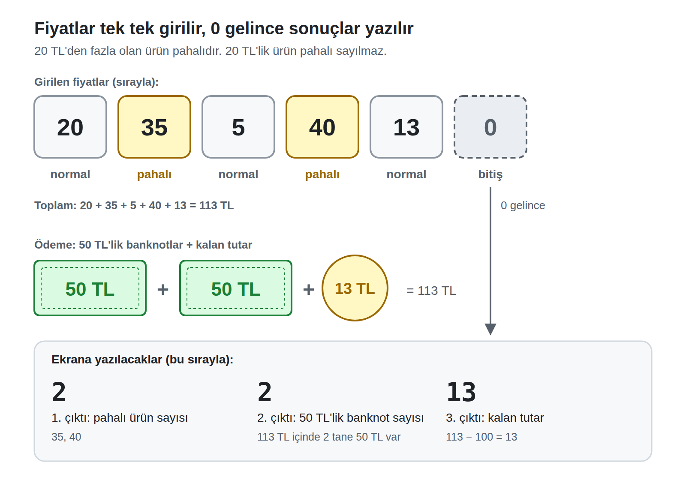

# Oyuncak Makine Uygulama Sınavı: B Grubu

**Süre:** 60 dakika · **Puan:** 100

Programınızı [Oyuncak Makine](https://toy.emrecan.dev/) simülatöründe yazınız ve çalıştırınız. Programınızı sadece verilen örneklerle değil, kendi seçtiğiniz girdilerle de deneyiniz.

**Hatırlatma**

- Komut satırları en az bir boşlukla başlar. Sadece etiketler (`basla`, `bitir` gibi) satırın en başından yazılır.
- Programınızı `stop` komutuyla bitirmeyi unutmayınız.
- Bellek hücrelerini programın sonunda tanımlayınız, örneğin `toplam  0`.

---

## Soru: Market kasası

**Durum:** Bir market kasasında ürünlerin fiyatları bilgisayara tek tek giriliyor. Fiyatlar 1 ile 100 TL arasında ve tam sayı. Bütün ürünler girilince `0` giriliyor. `0` "ürünler bitti" demek, bir fiyat değil.

Fiyatı **20 TL'den fazla** olan ürün **pahalı** sayılır.

Müşteri ödemeyi önce olabildiğince çok **50 TL'lik banknotla**, geri kalanını bozuk parayla yapacak.

**Görev:** `0` girilene kadar fiyatları okuyunuz. Giriş bitince sırasıyla şunları ekrana yazınız:

1. Pahalı ürün sayısı
2. Toplam tutar için gereken 50 TL'lik banknot sayısı
3. Banknotlardan sonra geriye kalan tutar

**Örnek**

| Girdiler | Toplam tutar | Ekrana yazılanlar |
| --- | --- | --- |
| `20, 35, 5, 40, 13, 0` | 113 TL | `2`, `2`, `13` |
| `8, 30, 0` | 38 TL | `1`, `0`, `38` |

**Açıklamalar**

- 20 TL'lik ürün pahalı sayılmaz.
- `0` bir fiyat değildir, hesaplamalara katılmaz.
- Toplam 50 TL'den az olabilir. O zaman banknot sayısı `0` olur.
- Banknot sayısı tam sayı olmalıdır. Örneğin 113 TL için `2.26` değil, `2` yazılmalıdır.
- En az bir ürün girilecektir.
