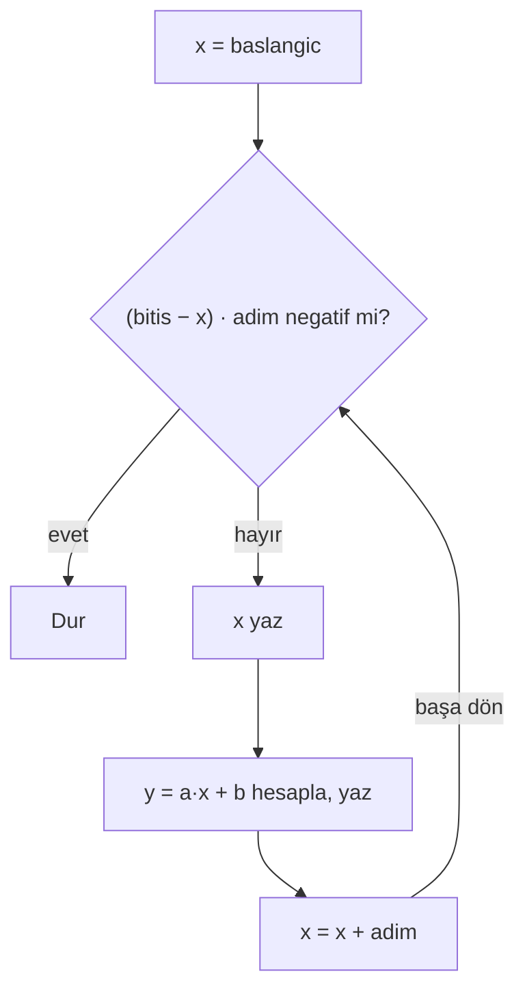
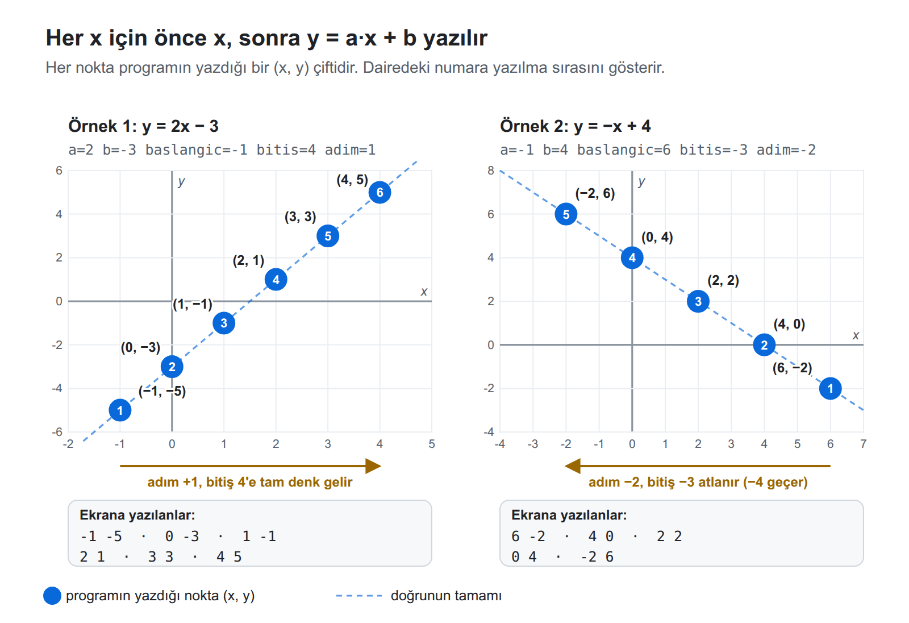

# Hafta 4, A Grubu: Doğrunun Değer Tablosu (Çözüm)

Soru metni `Hafta-4-A.md` dosyasındadır. B grubunun sorusu (Parabolün değer tablosu) bu soruyla aynı becerileri ölçer, ama A grubunun çözümü B grubuna uymaz. Karşılaştırma için en alttaki tabloya bakınız.

## Önce cümlelerle yazalım

Programı yazmadan önce ne yapacağımızı Türkçe cümlelerle yazıyoruz: programın her satırı için bir cümle. Cümleler aşağıdaki akış şemasını kutu kutu izler.

**Hangi bilgileri hatırlamamız gerekiyor?**

- Girdi hücreleri (değişmez): `a`, `b`, `baslangic`, `bitis`, `adim`
- Çalışma hücresi: `x` (o anki x değeri)

**Akış şeması**



**Satır satır cümleler**

| Satır | Şemadaki kutu | Cümle | Komut |
| --- | --- | --- | --- |
| 1 | x = baslangic | Başlangıç değerini akümülatöre getir. | `basla  load baslangic` |
| 2 | | Bu değeri x hücresine kopyala. x başlangıçtan başlasın. | `store x` |
| 3 | (bitis − x) · adim negatif mi? | Döngünün başı: bitiş değerini getir. | `dongu  load bitis` |
| 4 | | Bitişten x'i çıkar. Akümülatörde bitişe kalan yol var. | `sub x` |
| 5 | | Kalan yolu adımla çarp. (Bu satır yalnızca genel çözümde vardır. Adım pozitif çözümünde yoktur.) | `mul adim` |
| 6 | | Sonuç negatifse bitiş geçilmiştir, son satıra git. | `ifneg son` |
| 7 | x yaz | x'i akümülatöre getir. | `load x` |
| 8 | | x'i ekrana yaz. | `print` |
| 9 | y = a·x + b hesapla, yaz | Akümülatörde hâlâ x var, onu a ile çarp. | `mul a` |
| 10 | | Üzerine b'yi ekle. Akümülatörde artık y var. | `add b` |
| 11 | | y'yi ekrana yaz. | `print` |
| 12 | x = x + adim | x'i yeniden akümülatöre getir. | `load x` |
| 13 | | Üzerine adımı ekle. | `add adim` |
| 14 | | Yeni değeri x hücresine sakla. | `store x` |
| 15 | başa dön | Döngünün başına, 3. satıra dön. | `goto dongu` |
| 16 | Dur | Programı durdur. | `son  stop` |

**5. satırdaki tek çarpma neden işe yarar?** Girdi garantisi sayesinde bitiş geçilmediği sürece `bitis − x` ile `adim` aynı işaretlidir ve çarpımları 0 ya da pozitiftir. Bitiş geçildiği anda işaretler ters olur, çarpım negatife düşer. Bitişe tam denk gelinirse çarpım 0 olur ve o x de yazılır.

**9. satırda neden `load` yok?** `print` akümülatörü değiştirmez. 8. satırda x yazıldıktan sonra akümülatörde hâlâ x vardır. Bu yüzden y doğrudan `mul a`, `add b` ile hesaplanır ve y için ayrı bir hücre gerekmez.

## Adım pozitif olduğunda çözüm

Önce daha kolay bir basamak: adımın yalnızca pozitif olduğunu varsayan çözüm. x hep büyüyerek bitişe yaklaştığı için "bitiş geçildi mi?" sorusu tektir: bitişe kalan yol, yani `bitis − x`, negatif mi?

```
basla   load baslangic   # x, başlangıç değerinin kopyasıyla başlar
        store x
dongu   load bitis       # bitişe kalan yol: bitis - x
        sub x
        ifneg son        # negatifse x bitişi geçti, dur
        load x           # x'i yaz
        print
        mul a            # y = a*x + b (akümülatörde hâlâ x var)
        add b
        print            # y'yi yaz
        load x           # x = x + adim
        add adim
        store x
        goto dongu
son     stop
a         2
b         -3
baslangic -1
bitis     4
adim      1
x         0
```

15 komut. Örnek 1'deki gibi (bitiş 4, adım 1):

| x | bitis − x | Sonuç |
| --- | --- | --- |
| 3 | 1 | devam |
| 4 | 0 | devam, tam denk geldi, yazılır |
| 5 | −1 | **dur** |

Çıktı: `-1, -5, 0, -3, 1, -1, 2, 1, 3, 3, 4, 5`

Bu çözüm negatif adımla çalışmaz. Örnek 2'de (adım −2) `bitis − x` ilk turda negatif çıkar ve program hiçbir şey yazmadan durur. Negatif adımı da kapsamak için bir sonraki bölümdeki genel çözüme `mul adim` satırı eklenir.

## Genel çözüm (adım pozitif ya da negatif)

"Genel" sözcüğü, bu çözümün adımın **işareti ne olursa olsun** çalıştığını anlatır. Pozitif adım çözümü yalnızca x'in büyüyerek bitişe gittiği durumu bilir. Genel çözüm, x'in küçülerek bitişe indiği durumu (adım negatif, başlangıç bitişten büyük) da aynı kodla kapsar. İki çözümün döngüsü ve y hesabı aynıdır. Fark yalnızca "bitiş geçildi mi?" testindedir.

| Adım | Bitişe giderken x | Bitiş geçilmeden `bitis − x` | Bitiş geçilince `bitis − x` | Pozitif adım testi | Genel test |
| --- | --- | --- | --- | --- | --- |
| Pozitif | büyür | 0 ya da pozitif | negatif | doğru durur | doğru durur |
| Negatif | küçülür | 0 ya da negatif | pozitif | ilk turda yanlış durur | doğru durur |

Negatif adımda `bitis − x`'in işareti ters döndüğü için pozitif adım testi yetmez. Genel çözüm bu farkı tek satırla, `sub x`'ten sonra `mul adim` ile giderir. Kalan yolu adımla çarpınca, bitiş geçilmediği sürece iki işaret aynı olur ve çarpım 0 ya da pozitif çıkar. Bitiş geçildiği anda işaretler ters olur ve çarpım negatife düşer. Böylece tek `ifneg` iki yönde de doğru yerde durur. Bu ayrıntı yukarıda, "5. satırdaki tek çarpma neden işe yarar?" paragrafında da anlatıldı.

Bunun için girdi garantisi gerekir: adım 0 olmaz, adım pozitifse başlangıç bitişten büyük olmaz, adım negatifse başlangıç bitişten küçük olmaz.

```
basla   load baslangic   # x, başlangıç değerinin kopyasıyla başlar
        store x          # (baslangic hücresi değişmez)
dongu   load bitis       # (bitis - x) * adim hesapla
        sub x
        mul adim
        ifneg son        # negatifse bitiş geçildi
        load x           # x'i yaz
        print
        mul a            # y = a*x + b (akümülatörde hâlâ x var)
        add b
        print            # y'yi yaz
        load x           # x = x + adim
        add adim
        store x
        goto dongu
son     stop
# Hafta 4 A: Doğrunun değer tablosu, y = a*x + b
# Girdiler: denemek için yalnızca bu beş değeri değiştiriniz.
# (Örnek 1: y = 2x - 3, x: -1'den 4'e, adım 1)
a         2
b         -3
baslangic -1
bitis     4
adim      1
# Çalışma hücresi: program çalışırken değişir.
x         0
```

16 komut. 5 girdi hücresi ve 1 çalışma hücresi.

### Doğru kabul edilen farklı çözümler

- **İki dallı bitiş testi (ödevdeki gibi):** önce adımın işaretine bakılır, sonra adım pozitifse `bitis − x`, negatifse `x − bitis` negatif mi diye sorulur. 5 komut daha uzundur ve doğru kabul edilir.

  ```
  dongu   load adim        # önce adımın işareti
          ifneg azalan
          load bitis       # adım pozitif: bitis - x < 0 ise dur
          sub x
          ifneg son
          goto hesap
  azalan  load x           # adım negatif: x - bitis < 0 ise dur
          sub bitis
          ifneg son
  hesap   load x
          print
  ```

- y'nin `load a`, `mul x`, `add b` ile yeniden başlanarak hesaplanması, ya da `store y` ile saklanıp `load y`, `print` ile yazılması.
- Çalışma hücresine farklı ama anlamlı bir ad verilmesi (`simdikix`, `deger` gibi).

### Çalışan ama istenene uymayan çözümler

- **`baslangic` hücresini x olarak ilerletmek.** Çıktı doğru çıkar, çünkü Çalıştır her seferinde belleği yeniden yükler. Ama hücrenin adı artık içindekini anlatmaz ve girdi bozulur. Soruda açıkça yasaklanmıştır.
- **Girdileri `get` ile okumak.** Döngü ve hesap doğru olabilir, ama soru girdilerin bellekte durmasını ister.

## Çözüm nasıl çalışır: şekildeki iki örnek



Şekilde kesikli çizgi doğrunun tamamıdır. Her nokta programın yazdığı bir (x, y) çiftidir, dairedeki numara yazılma sırasını gösterir.

### Örnek 1: y = 2x − 3, x: −1'den 4'e, adım +1

Girdi hücreleri: `a = 2`, `b = -3`, `baslangic = -1`, `bitis = 4`, `adim = 1`

| Tur | x | (bitis − x) · adim | Devam? | a·x | y = a·x + b |
| --- | --- | --- | --- | --- | --- |
| 1 | −1 | (4 + 1) · 1 = 5 | evet | −2 | −5 |
| 2 | 0 | 4 | evet | 0 | −3 |
| 3 | 1 | 3 | evet | 2 | −1 |
| 4 | 2 | 2 | evet | 4 | 1 |
| 5 | 3 | 1 | evet | 6 | 3 |
| 6 | 4 | 0 | evet (tam denk) | 8 | 5 |
| — | 5 | −1 | **dur** | | |

Çıktı: `-1, -5, 0, -3, 1, -1, 2, 1, 3, 3, 4, 5`

Doğru x eksenini x = 1,5'te keser. Tablo tam sayılarla gittiği için kesim noktası tabloda görünmez: y, x = 1'de −1, x = 2'de 1 olur, yani işaret bu iki nokta arasında değişir.

### Örnek 2: y = −x + 4, x: 6'dan −3'e, adım −2

Girdi hücreleri: `a = -1`, `b = 4`, `baslangic = 6`, `bitis = -3`, `adim = -2`

| Tur | x | (bitis − x) · adim | Devam? | a·x | y = a·x + b |
| --- | --- | --- | --- | --- | --- |
| 1 | 6 | (−3 − 6) · (−2) = 18 | evet | −6 | −2 |
| 2 | 4 | (−7) · (−2) = 14 | evet | −4 | 0 |
| 3 | 2 | 10 | evet | −2 | 2 |
| 4 | 0 | 6 | evet | 0 | 4 |
| 5 | −2 | 2 | evet | 2 | 6 |
| — | −4 | (−3 + 4) · (−2) = −2 | **dur** | | |

Çıktı: `6, -2, 4, 0, 2, 2, 0, 4, -2, 6`

Bu örnek iki tuzağı birlikte yoklar:

- **Negatif adım:** x büyükten küçüğe gider. Yalnızca pozitif adım için yazılmış bir bitiş testi burada hiç nokta yazdırmaz.
- **Bitiş atlanır:** x, −3'e hiç denk gelmez, −2'den sonra −4'e geçer. −4 yazılmamalıdır.

## Test değerleri (gerçek simülatör motoruyla denendi)

Öğrenci dosyasındaki "Kendiniz deneyiniz" tablosundaki 5 deneme de aynı şekilde denendi.

| a | b | baslangic | bitis | adim | Beklenen çıktı | Neyi yoklar |
| --- | --- | --- | --- | --- | --- | --- |
| `2` | `-3` | `-1` | `4` | `1` | `-1, -5, 0, -3, 1, -1, 2, 1, 3, 3, 4, 5` | Örnek 1, bitişe tam denk gelme |
| `-1` | `4` | `6` | `-3` | `-2` | `6, -2, 4, 0, 2, 2, 0, 4, -2, 6` | Örnek 2, negatif adım, bitiş atlanır |
| `1` | `0` | `5` | `5` | `1` | `5, 5` | Başlangıç = bitiş, tek nokta |
| `0` | `0` | `-3` | `3` | `3` | `-3, 0, 0, 0, 3, 0` | a = 0, b = 0: yatay doğru y = 0 |
| `3` | `1` | `0` | `10` | `4` | `0, 1, 4, 13, 8, 25` | Adım 4, bitiş 10 atlanır |
| `-2` | `-1` | `0` | `-6` | `-3` | `0, -1, -3, 5, -6, 11` | Negatif adım, bitişe tam denk gelme |

## Sık yapılan hatalar

| Hata | Örnekte çıkan sonuç |
| --- | --- |
| `#` ile başlayan açıklama satırını kodun arasına yazmak | Program o satıra gelince takılır, "infinite loop?" uyarısı. O satırdan önce yazılanlar ekranda kalır |
| Satır başında sekme (Tab) kullanmak | "invalid opcode" hatası |
| x'i `baslangic`'tan kopyalamamak (x 0'dan başlar) | Örnek 1: `0, -3, 1, -1, 2, 1, 3, 3, 4, 5`. Örnek 2: `0, 4, -2, 6` |
| Adım pozitif çözümünü negatif adımla çalıştırmak (`mul adim` yok) | Örnek 1 doğru çıkar. Örnek 2'de ekrana hiçbir şey yazılmaz |
| Bitiş testinde 0'ı da "geçildi" saymak (`ifneg son` + `ifzero son`, ya da `ifpos` ile ters test) | Bitişe tam denk gelen son nokta yazılmaz. Örnek 1: `…, 3, 3` ile biter, `4, 5` eksik. Örnek 2 doğru çıkar |
| Girdi hücresinin adını farklı yazmak: `baslangic` ya da `adim` | "there is no statement labeled …" uyarısı, ekran `NaN` ile dolar, program durmaz ("infinite loop?") |
| Girdi hücresinin adını farklı yazmak: `bitis` | Uyarı gelir, ama `NaN` görünmez. Noktalar doğru yazılır, bitiş geçilince de durmaz (Örnek 1: `…, 4, 5, 5, 7, 6, 9, …`), "infinite loop?" |
| Girdi hücresinin adını farklı yazmak: `a` ya da `b` | Uyarı gelir, x'ler doğru, her y `NaN`. Program biter |
| x'e adımı eklememek ya da `store x` unutmak | Hep ilk nokta yazılır (Örnek 1: `-1, -5, -1, -5, …`), 10 000 komuttan sonra "infinite loop?" uyarısı |

## A ve B grubunun karşılaştırması

| Beceri | A: Doğru | B: Parabol |
| --- | --- | --- |
| Döngü | Ödevdeki başlangıç / bitiş / adım | Aynı |
| Girdi hücreleri | 5 | 6 |
| y hesabı | `a·x + b`, akümülatördeki x ile doğrudan (`mul a`, `add b`) | `(a·x + b)·x + c`, `load a` ile yeniden başlanır |
| Tuzak | Negatif adımda bitiş testi, `print`'ten sonra akümülatörde x'in kaldığını görmek | Aynı bitiş testi, x²'yi kurmak, `b·x` yerine `b` eklemek |
| Çözüm uzunluğu | 16 komut, 6 hücre | 19 komut, 7 hücre |

İki soru aynı döngüyü ister. Fark yalnızca y'nin hesabındadır: B'de 3 komut daha var ve formül daha kolay yanlış kurulur. Asıl iş iki grupta da döngü olduğu için iki soru yaklaşık aynı zorluktadır.
