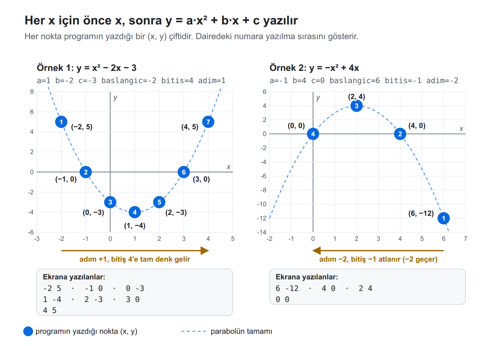

# Oyuncak Makine Uygulama Sınavı: B Grubu

**Süre:** 60 dakika

Programınızı [Oyuncak Makine](https://toy.emrecan.dev/) simülatöründe yazınız ve çalıştırınız. Programınızı sadece verilen örneklerle değil, kendi seçtiğiniz değerlerle de deneyiniz.

**Hatırlatma**

- Komut satırları en az bir boşlukla başlar. Sadece etiketler (`basla`, `bitir` gibi) satırın en başından yazılır. Satır başında sekme (Tab) değil, boşluk kullanınız.
- Programınızı `stop` komutuyla bitirmeyi unutmayınız.
- Bellek hücrelerini programın sonunda tanımlayınız, örneğin `toplam  0`.
- Açıklama yazmak isterseniz komutun sonuna, aynı satıra yazınız (`load x   # x'i getir`). `#` ile başlayan ayrı bir satır kodun arasında kalırsa simülatör o satırda takılır. Ayrı açıklama satırları yalnızca `stop`'tan sonra kullanılabilir.

---

## Soru: Parabolün değer tablosu

**Durum:** Bir parabolün denklemi `y = a·x² + b·x + c` şeklindedir. Parabolü çizmek için önce bir değer tablosu hazırlanır: x belli bir aralıkta adım adım değiştirilir ve her x için y hesaplanır.

Ödevdeki gibi x bir **başlangıç** değerinden başlar, her seferinde **adım** kadar değişir ve **bitiş** değeri geçilince durur. Adım pozitif ya da negatif olabilir.



**Girdiler bellekte:** Bu soruda sayılar klavyeden okunmaz (`get` kullanılmaz). Programınızın sonunda altı **girdi hücresi** tam bu adlarla bulunmalıdır. Hücreler, sayfanın sonundaki **Kod taslağı**'nda hazır yazılıdır.

**Görev:** Her x için önce **x'i**, sonra **y'yi** ekrana yazınız. Bitiş geçilince program dursun.

**Değişken adları:** Program çalışırken değişen o anki x değeri için ayrı bir hücre tanımlayınız ve ona ne tuttuğunu anlatan bir ad veriniz. Girdi hücrelerinin değerlerini program içinde değiştirmeyiniz. Örneğin x, `baslangic`'ın bir kopyasıyla başlamalı, `baslangic` hücresi bozulmamalıdır.

**Örnek**

| a | b | c | baslangic | bitis | adim | Ekrana yazılanlar |
| --- | --- | --- | --- | --- | --- | --- |
| `1` | `-2` | `-3` | `-2` | `4` | `1` | `-2, 5, -1, 0, 0, -3, 1, -4, 2, -3, 3, 0, 4, 5` |
| `-1` | `4` | `0` | `6` | `-1` | `-2` | `6, -12, 4, 0, 2, 4, 0, 0` |

1. örnekte (x, y) çiftleri `(-2, 5)`, `(-1, 0)`, `(0, -3)`, `(1, -4)`, `(2, -3)`, `(3, 0)`, `(4, 5)`.

**Açıklamalar**

- Değerler doğru verilir. Adım pozitifse başlangıç bitişten büyük olmaz. Adım negatifse başlangıç bitişten küçük olmaz. Adım 0 olmaz.
- Bitiş değerine tam denk gelinirse o x de yazılır (1. örnek). Denk gelinmezse bitişi geçen x yazılmaz (2. örnekte −1 atlanır, −2 yazılmaz).
- x² için x kendisiyle çarpılır (`mul x`).
- Hücre adını yanlış yazarsanız (örneğin `baslangıc`) simülatör "there is no statement labeled …" uyarısı verir ve ekrana `NaN` yazar. Bu uyarıyı görürseniz önce adları kontrol ediniz.

## Kod taslağı

Aşağıdaki taslağı kopyalayıp simülatöre yapıştırınız. Girdi hücrelerinde 1. örneğin değerleri hazır yazılıdır.

```
BU SATIRI SİL, KOMUTLARINI YAZ
a         1
b         -2
c         -3
baslangic -2
bitis     4
adim      1
```

**Önemli:** İlk satırı (`BU SATIRI SİL, KOMUTLARINI YAZ`) silip yerine komutlarınızı yazınız. Satırı silmeyi unutursanız simülatör `invalid opcode 'satiri' at 1` hatası verir ve durur.

Programınızı başka değerlerle denemek için yalnızca girdi hücrelerindeki sayıları değiştirip yeniden **Çalıştır**'a basınız.

## Kendiniz deneyiniz

Girdi hücrelerine aşağıdaki değerleri yazıp programınızı çalıştırınız. Her deneme 4 ya da 5 nokta (x, y) yazdırır. Ekranda sırasıyla her noktanın x'i ve y'si görünmelidir.

| # | Parabol | a | b | c | baslangic | bitis | adim | Yazılması gereken noktalar (x, y) | Neyi dener |
| --- | --- | --- | --- | --- | --- | --- | --- | --- | --- |
| 1 | y = x² | `1` | `0` | `0` | `-2` | `2` | `1` | (−2, 4) (−1, 1) (0, 0) (1, 1) (2, 4) | En basit parabol |
| 2 | y = x² − 4 | `1` | `0` | `-4` | `3` | `-4` | `-2` | (3, 5) (1, −3) (−1, −3) (−3, 5) | Negatif adım, bitiş −4 atlanır (4 nokta) |
| 3 | y = −x² + 9 | `-1` | `0` | `9` | `-4` | `4` | `2` | (−4, −7) (−2, 5) (0, 9) (2, 5) (4, −7) | a negatif: parabol aşağı açılır |
| 4 | y = 2x² − 4x | `2` | `-4` | `0` | `-1` | `3` | `1` | (−1, 6) (0, 0) (1, −2) (2, 0) (3, 6) | c = 0, kökler x = 0 ve x = 2 |
| 5 | y = x² − 6x + 5 | `1` | `-6` | `5` | `7` | `-1` | `-2` | (7, 12) (5, 0) (3, −4) (1, 0) (−1, 12) | Üç katsayı da dolu, kökler x = 1 ve x = 5 |

Örneğin 1. denemede ekranda sırasıyla `-2, 4, -1, 1, 0, 0, 1, 1, 2, 4` görünmelidir.
